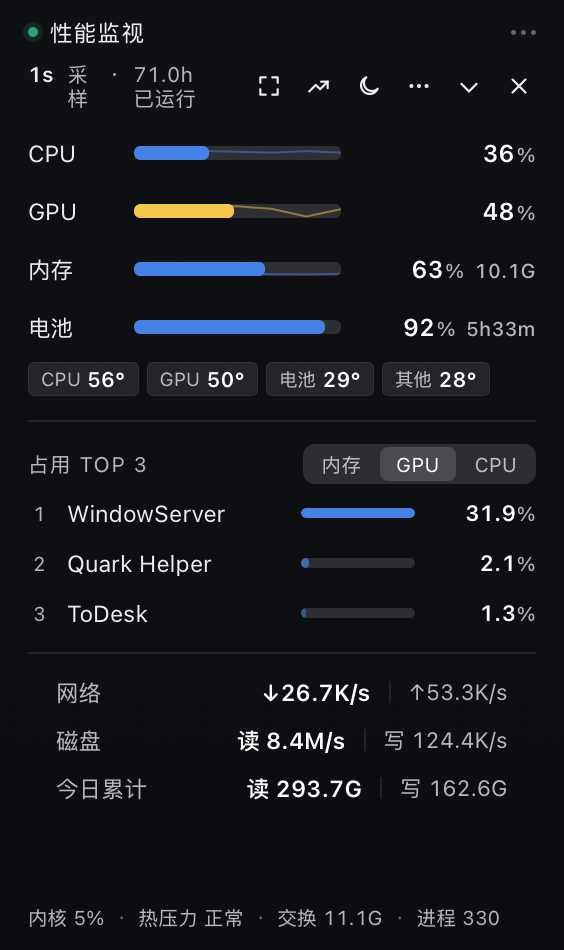
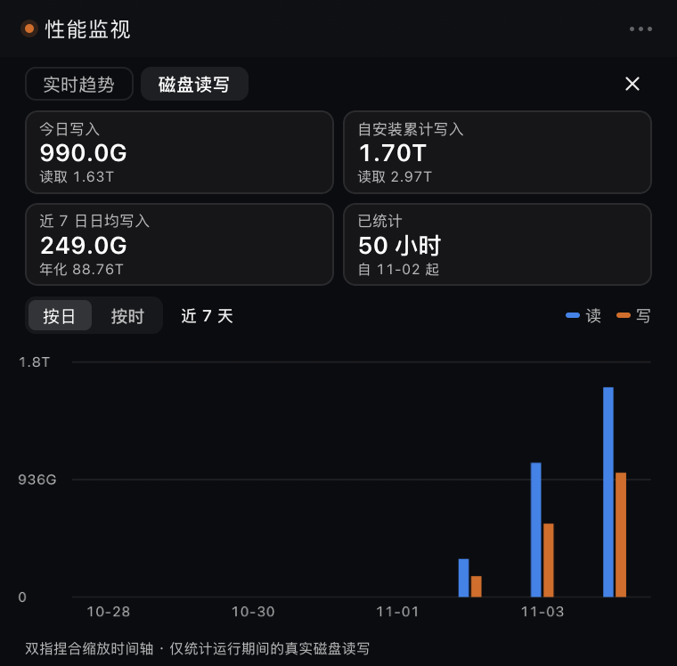
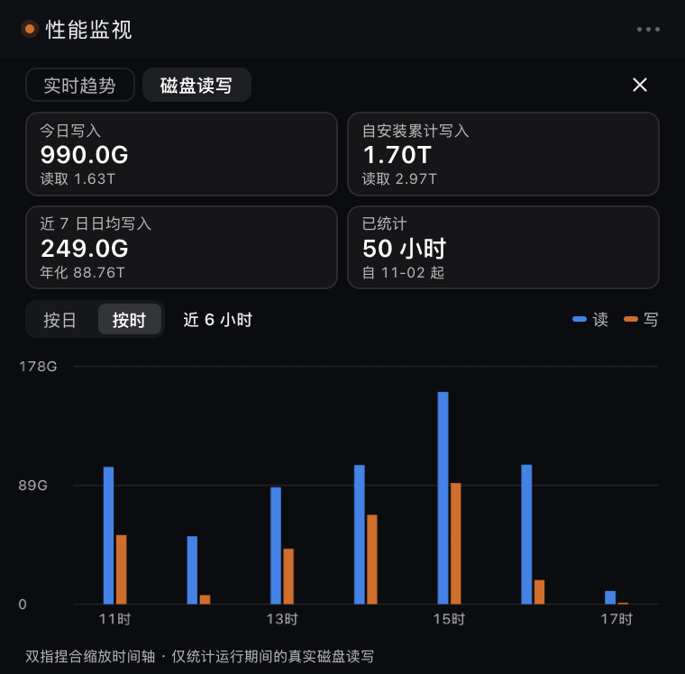
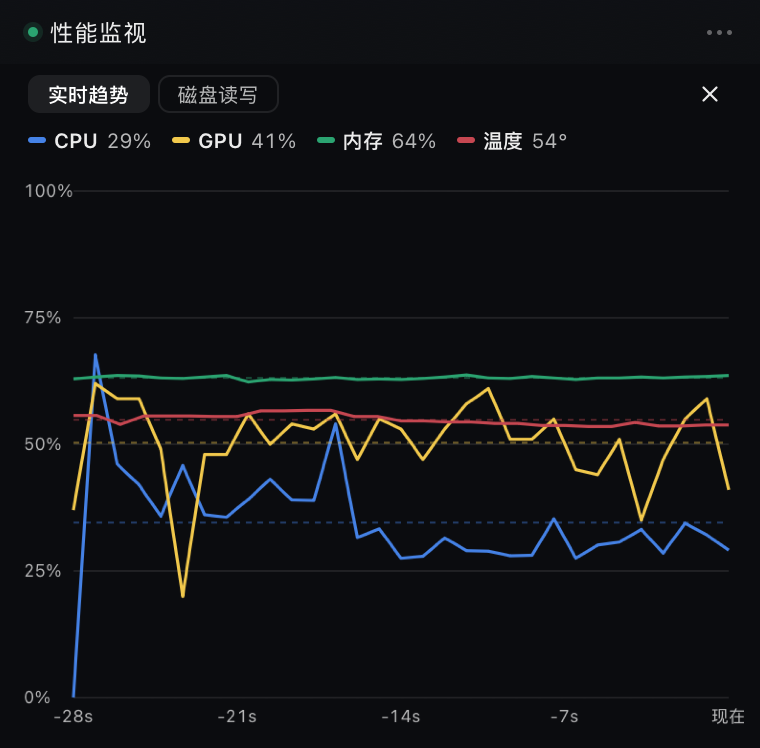
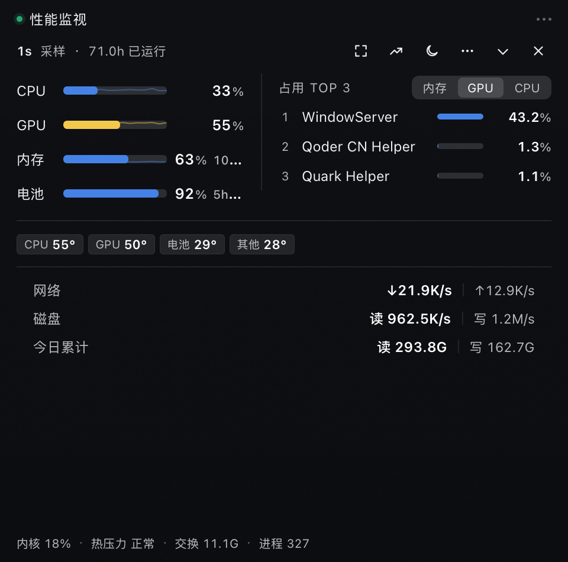
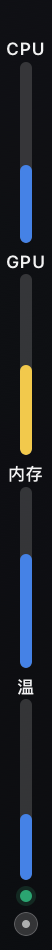
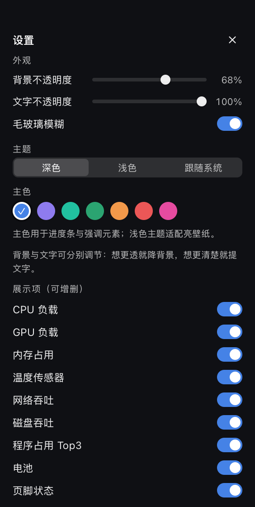

# PerfDock — macOS 桌面性能悬浮窗

**When a Mac slows down under agent workloads, PerfDock makes resource use easier to inspect.** A compact native macOS monitor for CPU, GPU, memory, temperature, processes, network, and real disk I/O, with live trends and local disk history.

**PerfDock 是一款原生 macOS 桌面性能悬浮窗。** 当 MacBook 在运行 Agent 或多任务时变得迟缓，PerfDock 帮你观察 CPU、GPU、内存、温度、进程和磁盘读写，查看资源分配与近期变化。

> 当前源码版本：**1.0.4（Build 5）** · 最低系统：**macOS 12** · 主要在 **Apple Silicon** 上开发和验证。

## 为什么做 PerfDock

macOS 自带的活动监视器能展示大量系统信息，但当工作流中有多个 Agent、辅助进程和开发工具时，切换窗口和定位资源变化并不总是方便。机器开始卡顿时，使用者常常不知道是 CPU、GPU、内存压力、某个进程，还是持续的磁盘读写更值得检查。

PerfDock 把常用指标放在桌面边缘，支持查看进程排行、磁盘读写速率、累计读写和历史曲线。它帮助你**观察和比较资源使用情况**，供进一步排查；它不会自动判断某次卡顿的原因，也不会自动结束进程或修复系统。

## 真实界面与磁盘记录示例

以下图片来自作者设备的实际运行截图，包含截图时的真实系统读数。硬件、工作负载和采样起始时间会影响结果，这些数字不是性能基准或推荐目标。

### 实时面板

### 磁盘读写：较高吞吐量场景

这次记录约运行 50 小时：截图时显示**当日写入 990 GB、读取 1.63 TB**；自开始记账以来累计写入 **1.70 TB、读取 2.97 TB**；近 7 日平均写入 **249 GB/日**。这是作者在密集 Agent 与开发工作负载下的一次真实观察，说明为什么只看瞬时 CPU 使用率可能不足以理解磁盘活动。

磁盘累计从 PerfDock 开始运行并采样时记账，不是 SSD 自出厂起的 SMART 总写入量。当前 macOS 公开可用的数据不提供该设备的 NVMe SMART 生命周期写入量；应用读取块设备累计 I/O，并把采样间的差值按小时累加。应用未运行期间的数据无法补记。

### 趋势与布局

| 横向双栏 | 贴边竖向迷你条 | 贴边横向迷你条 |
|---|---|---|
|  |  |  |

## 功能一览

- **CPU**：总负载、用户态/系统态、每核数据和进程排行。
- **GPU**：设备利用率；可用时按进程 GPU 时间估算归因。
- **内存**：已用、压缩、可回收、交换空间等信息。
- **温度**：读取 AppleSMC 温度传感器，并按传感器组汇总；悬停查看可用的原始条目。
- **进程 TOP 3**：按内存、CPU 或 GPU 排序；CPU 可切换整机容量与单核口径。
- **网络**：基于网卡字节计数的上下行速率。
- **磁盘**：块设备读取/写入速率、每日累计、按日或按小时查看历史。独立 1 秒采样；历史保留 120 天小时桶。
- **趋势**：CPU、GPU、内存和温度的近期曲线。
- **桌面交互**：菜单栏读数、全局快捷键 ⌥⇧P、四边吸附、贴边迷你条、窗口预设、主题和主色设置。
- **WorkBuddy 联动**：可随 WorkBuddy 启动显示，退出时可自动收起；此联动可在设置中关闭。

9 个模块可分别开关。磁盘与网络模块默认关闭；第一次启用磁盘历史后，数据从 PerfDock 运行期间逐步累积。

## 下载和运行

项目发布页提供可直接运行的 macOS 安装包。首次下载请前往 GitHub **Releases** 获取最新版 PerfDock-版本号-macOS.zip，展开后把 PerfDock.app 移到「应用程序」并打开。

应用使用本地 ad-hoc 签名，当前未经过 Apple Developer ID 公证。若 macOS 首次阻止打开，可在 Finder 中对 App 点右键选择「打开」，再按系统提示确认。请只从本项目的 GitHub Releases 下载官方构建。

## 从源码构建

需要 macOS 12 或更高版本以及 Xcode 命令行工具（包含 swiftc）。不需要 Swift Package Manager、CocoaPods 或其他第三方运行时依赖。

<pre><code>git clone https://github.com/tunianbututou/PerfDock.git
cd PerfDock
./build.sh
open build/PerfDock.app</code></pre>

build.sh 在当前 Mac 上调用系统 Swift 编译器，生成本机架构的 build/PerfDock.app 并进行 ad-hoc 签名。当前脚本以 Apple Silicon 为主要验证目标；尚未声明 Intel Mac 的指标采集兼容性。源码构建完成后，build/ 中会出现应用包。

## 界面检查

外观回归程序在独立测试进程中运行，不启动正式应用生命周期、登录启动项或磁盘采样：

<pre><code>mkdir -p work
swiftc -swift-version 5 \
  Sources/app/Prefs.swift Sources/app/Panel.swift \
  Tests/Appearance/main.swift \
  -framework AppKit -framework WebKit \
  -o work/appearance-test
./work/appearance-test</code></pre>

检查覆盖深浅主题、毛玻璃开关、8%/42%/100% 背景不透明度、真实 WKWebView 中的设置页滑块，以及文字不透明度是否独立。需要可用的 macOS 图形会话。

## 数据、隐私与权限

PerfDock 只在本机展示指标，没有账号登录、遥测上传、云端服务或网络请求功能。运行时不要求管理员密码、辅助功能或全盘访问权限。

- **偏好与窗口状态**：UserDefaults，应用域 com.perfdock.app。
- **磁盘历史**：~/Library/Application Support/PerfDock/disk-history.json。
- **登录启动项**：~/Library/LaunchAgents/com.perfdock.agent.plist；可在设置中关闭。
- **截图提示**：本仓库的界面截图包含作者设备当时的系统读数、磁盘读写数值以及部分进程名称。它们被明确用作功能样例；请在复用截图前评估其是否适合公开。

升级时替换应用包并保留上述数据位置即可；不要删除应用支持目录。完整端到端自检 --selftest 会操作偏好与窗口状态并初始化磁盘历史，应只在测试账户中运行。

## 指标来源与解读边界

| 指标 | 主要来源 | 解释 |
|---|---|---|
| CPU | Mach host_processor_info | 用相邻采样间的 tick 差值计算负载；普通进程不能枚举的内核活动不会伪装成可见进程。 |
| 内存与交换 | host_statistics64、sysctl vm.swapusage | 页面显示系统统计数据；与其他工具的分类名称可能不完全相同。 |
| GPU | IOKit IOAccelerator 设备利用率 | GPU 活动使用系统提供的设备统计。分进程 GPU 归因取决于系统接口、客户端可见性及累计 GPU 时间，属于估算。 |
| 温度 | AppleSMC | 显示能读取到的传感器值；SMC key 与物理位置并不总能一一确认，汇总不等于机身表面温度。 |
| 网络 | 接口累计字节数的相邻差值 | 设备总接口流量；不能直接归属到每个进程。 |
| 磁盘 | IOKit IOBlockStorageDriver 统计 | 块设备累计读写计数器的相邻差值；按小时持久化本应用运行期间观察到的增量。 |
| 进程 | macOS libproc，以及可用的 GPU 客户端信息 | 系统保护的进程可能不可见；程序排行是当前能观察到的进程，不一定覆盖整机全部活动。 |

部分采集涉及系统底层接口或 IOKit 服务。设备型号、macOS 版本和系统安全策略可能导致某些指标不可用或变化；拿不到的数据应视为不可用，不能把界面数值当作维修诊断结论。

## 项目结构

<pre><code>PerfDock/
├── Sources/
│   ├── Metrics.swift            # CPU、GPU、内存、进程、网络和磁盘采集
│   ├── SMCTemp.swift            # AppleSMC 温度读取
│   ├── app/
│   │   ├── main.swift           # 生命周期、菜单栏、采样、快捷键、WorkBuddy 联动
│   │   ├── Panel.swift          # AppKit 窗口、吸附/折叠、WKWebView 桥接
│   │   ├── Prefs.swift          # UserDefaults 偏好与前端 JSON 同步
│   │   └── DiskHistory.swift    # 磁盘 I/O 增量、小时桶与本地持久化
│   ├── probe/main.swift         # 开发期指标探针
│   └── snap/main.swift          # 开发期 UI 截图工具
├── UI/index.html               # 界面、交互、趋势图和设置
├── Tests/Appearance/           # 外观回归检查
├── docs/images/                # 本机实机界面样图
├── Info.plist
└── build.sh</code></pre>

更详细的模块边界和数据流见 [架构说明](docs/ARCHITECTURE.md)。

## 开源许可

本项目以 [MIT License](LICENSE) 发布。指标依赖 Apple 平台框架和设备接口；其可用性仍受 macOS 与硬件支持范围限制。

---

## English

### PerfDock — a native macOS desktop performance monitor

PerfDock is a compact native macOS monitor for CPU, GPU, memory, temperature, processes, network traffic, and disk I/O. It keeps frequently checked system metrics near the edge of the desktop and adds live trends and local disk history.

The project started from a familiar problem: a MacBook can feel sluggish while several agents or developer tools are running, yet it is not immediately clear which process or resource deserves attention. PerfDock helps users observe and compare resource usage. It does not diagnose every slowdown automatically, terminate processes, or repair the system.

### Screenshots from real use

The screenshots in this repository were captured from a running app on the developer’s Mac. They contain live system and disk counters from those capture times. Results vary with hardware, workload, and sampling history; the figures are illustrative examples rather than performance benchmarks.

The disk-history capture below shows a high-throughput workload after about 50 hours of local sampling: 990 GB written and 1.63 TB read that day, with 1.70 TB written and 2.97 TB read since tracking began. The seven-day average at capture time was 249 GB written per day. This is one real workload snapshot, not a typical or recommended target.

Disk history is collected only while PerfDock is running. It records observed block-device read/write counter deltas and is not the SSD’s lifetime SMART write total. Gaps while the app is stopped cannot be backfilled.

### Features

- CPU total and per-core usage, GPU utilization, memory and swap statistics, temperature sensors, battery state, network rates, and disk I/O.
- Process ranking by memory, CPU, or GPU when the relevant system data is available.
- Live trends for CPU, GPU, memory, and temperature.
- Disk throughput plus local hourly and daily history, retained for up to 120 days of hourly buckets.
- Independent switches for nine display modules; network and disk rows start disabled.
- Edge docking, vertical and horizontal mini modes, a two-column wide layout, window presets, and always-on-top behavior.
- Dark, light, and system-matched appearance, adjustable background and text opacity, and a global ⌥⇧P visibility shortcut.
- Optional display behavior tied to WorkBuddy launch and quit events.

### Data sources and interpretation

| Metric | Source | Notes |
|---|---|---|
| CPU | Mach host processor statistics | Usage is computed from differences between consecutive counters. Some kernel activity cannot be attributed to visible user processes. |
| Memory and swap | host_statistics64 and sysctl | System accounting categories may differ from other monitors. |
| GPU | IOKit IOAccelerator statistics | Device utilization comes from system counters. Per-process attribution is an estimate based on visible clients and cumulative GPU time. |
| Temperature | AppleSMC | Sensor names do not guarantee a known physical location; a group summary is not necessarily a chassis-surface temperature. |
| Network | Network-interface byte counters | Shows interface throughput and does not attribute traffic to individual processes. |
| Disk | IOKit IOBlockStorageDriver counters | Adjacent byte-counter deltas feed throughput and local hourly history. |
| Processes | macOS libproc and available GPU client data | Protected or kernel processes may be unavailable, so a process list may not account for all device activity. |

Some metrics depend on low-level system interfaces whose availability can vary by Mac model and macOS version. Missing data should remain unavailable rather than be treated as a reliable diagnostic result. GPU attribution is approximate; PerfDock is a monitoring aid, not a service that guarantees the cause of a slowdown.

### Build from source

Requirements: macOS 12 or later, Xcode Command Line Tools, and Swift 5. The build script targets the current machine architecture and the project is primarily validated on Apple Silicon. It uses Apple system frameworks and has no third-party runtime dependencies.

<pre><code>git clone https://github.com/tunianbututou/PerfDock.git
cd PerfDock
./build.sh
open build/PerfDock.app</code></pre>

The app is locally ad-hoc signed and is not notarized with an Apple Developer ID. The latest downloadable build is available from [GitHub Releases](https://github.com/tunianbututou/PerfDock/releases/latest). On first launch, macOS may require opening the downloaded app through Finder’s right-click menu.

### Data and privacy

Preferences and window state are stored in the local UserDefaults domain com.perfdock.app. Disk history is stored under ~/Library/Application Support/PerfDock/disk-history.json, and the optional login agent is under ~/Library/LaunchAgents/. Disk history can contain usage patterns; screenshots can contain quota values, process names, and system readings. Review such files before sharing them.

PerfDock itself has no login, telemetry backend, or cloud service. It does not require administrator credentials, Accessibility permission, or Full Disk Access for its documented monitoring features.

### License

PerfDock is available under the [MIT License](LICENSE).
